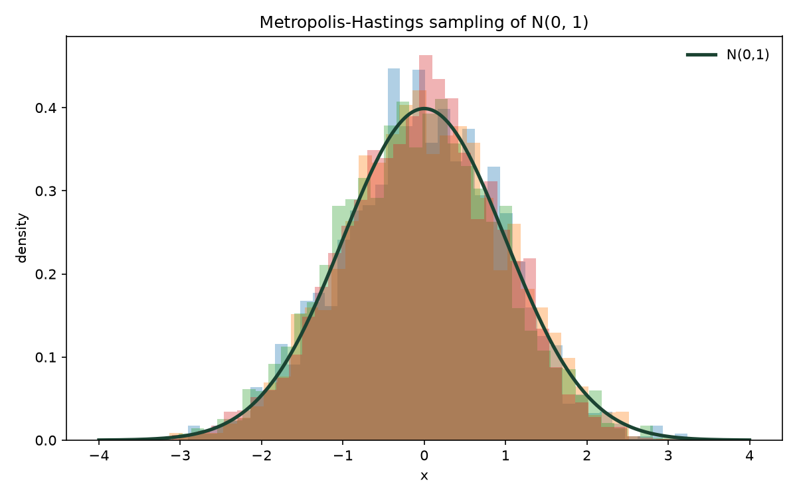
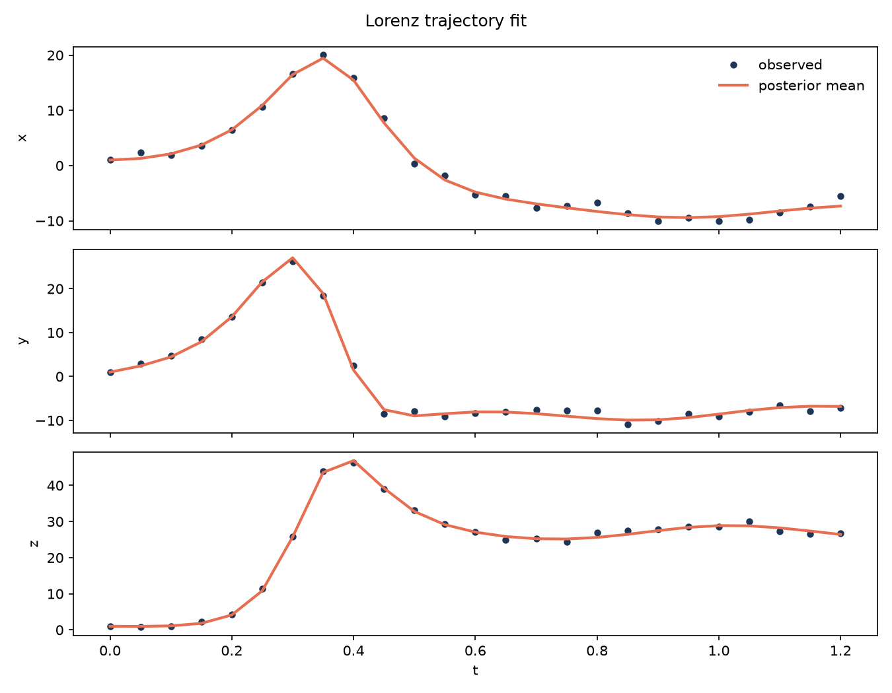
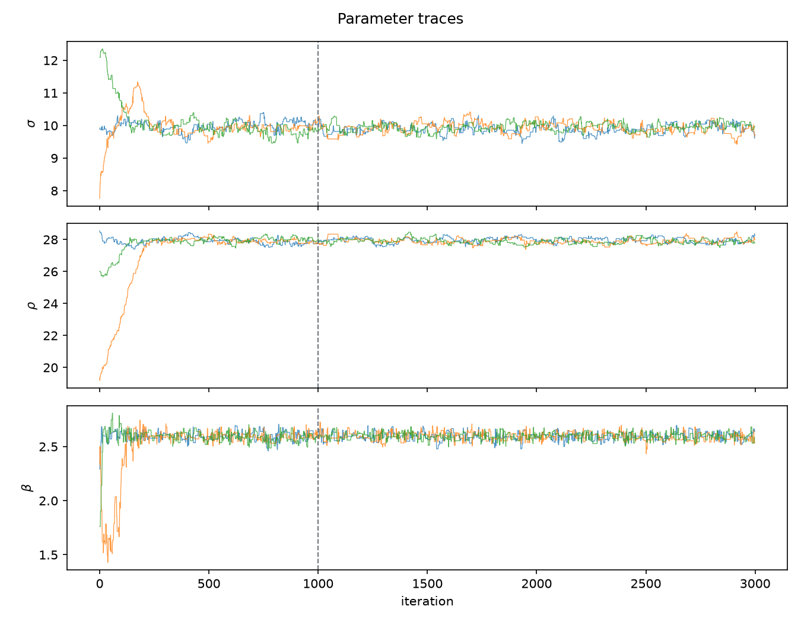
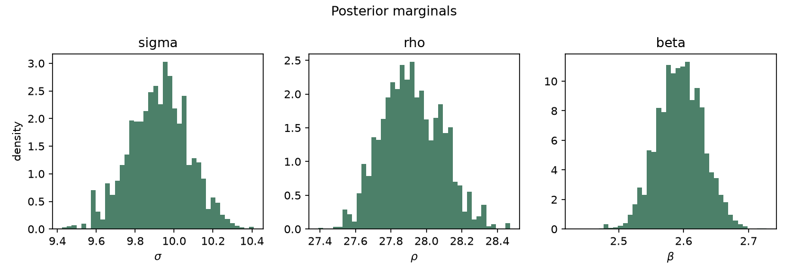

# Metropolis-Hastings MCMC: Density Sampling & Lorenz Inference

A given trajectory is noisy. The dynamical system behind it is chaotic. Point estimates alone are not enough — you need parameters **and** uncertainty.

This repository is a compact computational-statistics case study built around that problem. It starts by proving a Metropolis-Hastings sampler on a known target, then uses the same engine to recover Lorenz-63 parameters \((\sigma, \rho, \beta)\) from a short observed path.

<p align="center">
  
  
</p>
<p align="center">
  <em>Left:</em> sampler validation on \(N(0,1)\).
  &nbsp;&nbsp;
  <em>Right:</em> Lorenz trajectory reconstructed from the posterior mean.
</p>

<p align="center">
  
  
</p>
<p align="center">
  <em>Left:</em> parameter traces across chains.
  &nbsp;&nbsp;
  <em>Right:</em> posterior marginals for \((\sigma, \rho, \beta)\).
</p>

## What is inside

| Piece | Role |
| --- | --- |
| Sampler validation | Multi-chain MH recovers \(N(0,1)\); histograms vs analytical density |
| Lorenz inference | Bayesian recovery of \((\sigma, \rho, \beta)\) from noisy states |
| Diagnostics | Acceptance rate, Gelman-Rubin \(\hat{R}\), effective sample size (ESS) |
| C backend | Optional OpenMP-ready multi-chain Normal sampler via `ctypes` |
| Engineering | Packaged Python module, pytest suite, GitHub Actions CI |

Numerical summaries for the default seeds live in [docs/results.md](docs/results.md). Design notes: [docs/use-case.md](docs/use-case.md), [docs/architecture.md](docs/architecture.md).

## Project structure

```text
src/mcmc_lab/   sampler, Lorenz model, diagnostics, C bridge, plotting, CLI
c_sampler/      C library + CLI for Normal-target MH (independent chains)
data/           synthetic + legacy observational trajectories
examples/       runnable entry points
tests/          pytest suite
docs/           use-case, architecture, results, figures
.github/        CI workflow
outputs/        generated figures
```

## Setup

```bash
python3 -m pip install -e ".[dev]"
make c-sampler   # optional shared library for the C backend
```

## Run

```bash
make test

python -m mcmc_lab sample-normal
python -m mcmc_lab infer-lorenz
python -m mcmc_lab sample-normal-c 2000 4   # requires make c-sampler
```

## Method (short)

- **Target 1:** \(\log p(x) = -\frac{1}{2}x^2 + const\), random-walk proposals.
- **Target 2:** Lorenz-63 ODE integrated with SciPy; Gaussian likelihood on state residuals; box prior on parameters.
- **Diagnostics:** acceptance rate, multi-chain \(\hat{R}\), and ESS.

Primary inference data: short synthetic Lorenz-63 path with known truth \((10,\ 28,\ 8/3)\) and Gaussian noise. Archival assignment data remains at `data/legacy_observations.dat`.

## Stack

Python 3.10+ · NumPy · SciPy · Matplotlib · pytest · GCC (optional OpenMP) · GitHub Actions

